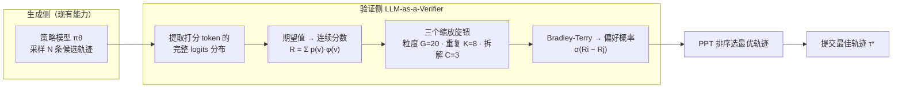
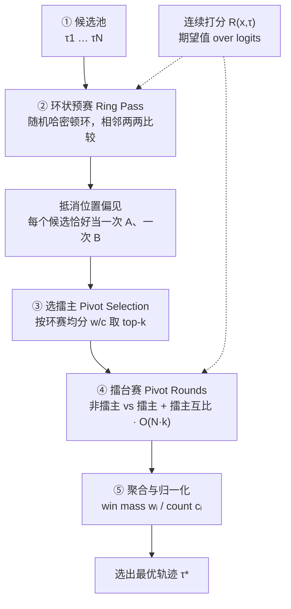
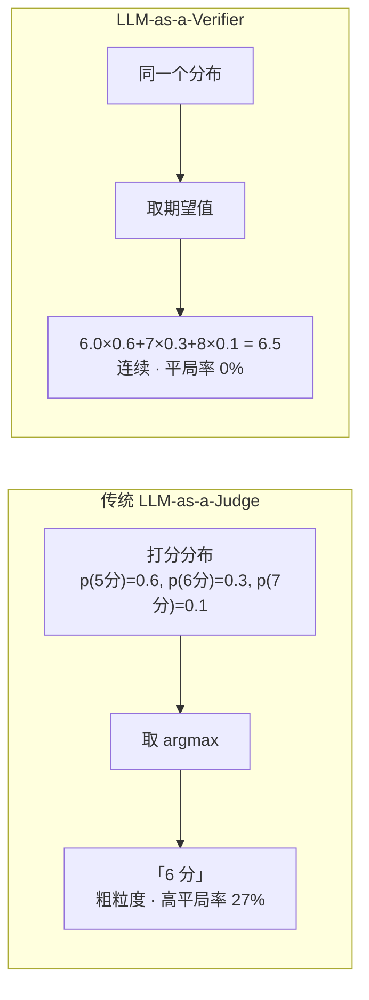

# LLM-as-a-Verifier：把「验证」做成新的缩放轴

> 论文：Jacky Kwok et al., *LLM-as-a-Verifier: A General-Purpose Verification Framework*, arXiv:2607.05391（Stanford / UC Berkeley / NVIDIA）

---

## 一、一句话总结

传统的 test-time compute 核心是「**让生成变强**」（多思考、多采样、搜索）。这篇论文换了个角度：

> **「生成」其实已经够强了，瓶颈在「裁判」（verifier）不够强。** 它把「验证 / 打分」本身当成一个**新的、独立的 scaling 轴**，并给出一套**不需要训练、即插即用**的精细化打分框架。

---

## 二、背景：前情回顾（Test-Time Compute）

- 大模型训练时已学会知识，test-time compute 指「**答题那一刻**多花算力」——打草稿、多试几次、自己检查。
- 常见做法：思维链（CoT）、Best-of-N 采样、多数投票 / 自我一致性、树搜索（MCTS）、过程奖励模型（PRM）/ 结果奖励模型（ORM）、强化学习训练「会思考」的模型（o1 / DeepSeek R1）。
- 这些都属于**生成侧**的缩放。本文补上**验证侧**的缩放。

---

## 三、这篇论文解决什么问题

### 3.1 动机：模型已经能生成正确答案，只是没人挑得出来

论文开头有个关键数据：

> 在 Terminal-Bench 上，若有一个「永远能挑对答案的神裁判」（Oracle），把多个模型的轨迹收集起来，成功率可达 **98.9%** ——几乎整个基准都能做对。

即：**瓶颈不在生成，而在验证。**

### 3.2 传统 LLM-as-a-judge 的致命伤：离散分数 → 大量平局

传统裁判让模型输出一个**离散整数分数**（如 1~5 分），再取概率最高的那个。结果是**平局（tie）**：两个明显不同的轨迹被打成同一个分，裁判无法区分。论文实测平局率高达 **27%**。

---

## 四、核心实现（三个关键技术）

### 4.1 用「期望值」替代「最高概率的那一个分数」

传统（离散）：

$$R_{\text{LM}} = \arg\max_g\; p_\theta(v_g) \quad \longleftarrow \text{只取概率最高的那个分数 token}$$

本文（连续）：

$$R(x,\tau) = \frac{1}{CK}\sum_{c=1}^{C}\sum_{k=1}^{K}\sum_{g=1}^{G} p_\theta(v_g \mid x,c,\tau)\,\varphi(v_g)$$

直觉解释：

- 传统裁判让模型「拍脑袋报一个整数分」，把模型心里丰富的「分数概率分布」**压扁成一个点**。
- 新方法让模型**把整个概率分布都贡献出来**，再算**加权平均（期望值）**。

> 例子：模型心里想「80% 概率 8 分、15% 概率 7 分、5% 概率 9 分」。传统裁判只会喊「8 分」；新方法算出 $8\times0.8 + 7\times0.15 + 9\times0.05 = 7.9$。于是两个「同样被喊 8 分」的答案变成 8.1 vs 7.9，**平局彻底消除**（实测 27% → 0%）。

> 工程细节：故意用**字母标尺**（而非数字 1~20），才能稳定提取每个 token 的 log-probability。

### 4.2 验证的三个「缩放旋钮」

验证可沿三个**相互独立**的维度缩放，每个针对一种误差来源：

| 旋钮 | 符号 | 针对的误差 | 效果 |
|------|------|-----------|------|
| **分数粒度** granularity | G（1→20） | 分数太粗，分不开好坏 | 更细刻度表达「内心信念」，提高信噪比 SNR |
| **重复评估** repetition | K（1→16） | 单次打分有随机波动 | 蒙特卡洛平均，方差按 O(1/K) 下降 |
| **标准拆解** decomposition | C（1→3） | 一个笼统标准有偏差 | 拆成规格/输出/错误三个子标准再取平均 |

三个旋钮**叠加使用**，验证准确率从 **73.1% → 78.3%**，且各自独立贡献。

其中「标准拆解」把笼统的「这个轨迹对不对？」拆成三个更具体的问题：

- **Specification**：是否满足任务所有要求？
- **Output**：最终输出格式对不对？
- **Errors**：日志和工具输出里有没有失败信号？

### 4.3 省钱的排序算法：Probabilistic Pivot Tournament（PPT）

从 N 个候选中选最优，最笨的两两全比（round-robin）是 O(N²)。PPT 降到 **O(N·k)**：

1. **环状预赛（Ring pass）**：随机哈密顿环，让每个候选恰好当一次「A 选手」、一次「B 选手」→ 抵消模型的**位置偏见**。
2. **选擂主（Pivot selection）**：按环赛得分取 top-k 当擂主。
3. **擂台赛（Pivot rounds）**：其余候选只跟 k 个擂主比，把预算集中在「最有希望的人」身上。

用连续分数差套 **Bradley-Terry 模型**（sigmoid）算出偏好概率：

$$P(\tau_i \succ \tau_j) = \frac{1}{1 + \exp(-(R_i - R_j))}$$

---

## 五、流程图

### 5.1 整体框架：生成 + 验证 解耦

### 5.2 PPT 排序算法五阶段流程

### 5.3 离散 vs 连续：为什么能消除平局

---

## 六、对比传统技术：新在哪里

| 传统技术 | 本文做法 | 区别 |
|---------|---------|------|
| verifier 只是「辅助工具」（Best-of-N 的裁判） | 把 **verification 本身当成独立 scaling 轴** | 视角升级：验证也有自己的 scaling law |
| 裁判输出**离散分数**（PRM 给步骤、ORM 给答案） | 输出**连续分数**（logit 分布期望值） | 核心技巧：消除平局、提高区分度 |
| PRM / ORM 需**额外训练**、跨域泛化差 | **零训练、即插即用**，一套框架通吃代码/机器人/医疗 | 更通用、更便宜 |
| 多数投票、自我一致性（**生成侧**多样化） | 在**验证侧**做三维缩放（粒度/重复/拆解） | 把算力花在「打分」而非「生成」 |
| 树搜索 / MCTS（搜生成路径） | **Probabilistic Pivot Tournament**（搜候选排序） | 新的成本优化排序，顺带抵消位置偏见 |
| 一般只处理**最终答案**或**单步** | 处理**整条 agent 交互轨迹**（trajectory-level） | 更适配长程 agent 任务 |
| 主要针对**文本** | 支持**多模态**（机器人视频用 VLM 打分） | 适用面更广 |

**最核心的一条新思想**：把「打分」从「报一个整数」变成「**报一个概率分布，再取期望**」。就这一个数学改动，让验证从「粗粒度、易平局」变成「细粒度、可缩放」。

---

## 七、三大应用（细粒度分数是万能信号）

1. **Test-time scaling（挑最佳答案）**：Terminal-Bench V2（86.5%）、SWE-Bench Verified（78.2%）、RoboRewardBench（87.4%）、MedAgentBench（73.3%）全部刷新 SOTA。
2. **进度监控（progress tracking）**：分数单调上升反映 agent「做到哪步」，失败轨迹分数停滞/下降（VOC 相关系数 0.848~0.966）。做了 Claude Code / Codex 插件，实时预警 agent 卡住。
3. **强化学习密集奖励**：连续分数当 reward，SAC 样本效率提升 **1.8×**，GRPO 提升 **1.1×**。

---

## 八、局限（论文自述）

- 依赖 log-probability：GPT-5.5 / Claude 等闭源 API 不给 logits，需「两阶段绕路」（闭源模型写推理 → 开源模型读 logits 打分）。
- 三个旋钮是手工设计，未来可学习/动态生成。
- RL 实验目前只在单轮设置，多轮未验证。

---

## 九、参考

- arXiv:2607.05391 — *LLM-as-a-Verifier: A General-Purpose Verification Framework*
- 前情：`test-time compute` 缩放定律 → Snell et al., *Scaling LLM Test-Time Compute Optimally*（arXiv:2408.03314）
